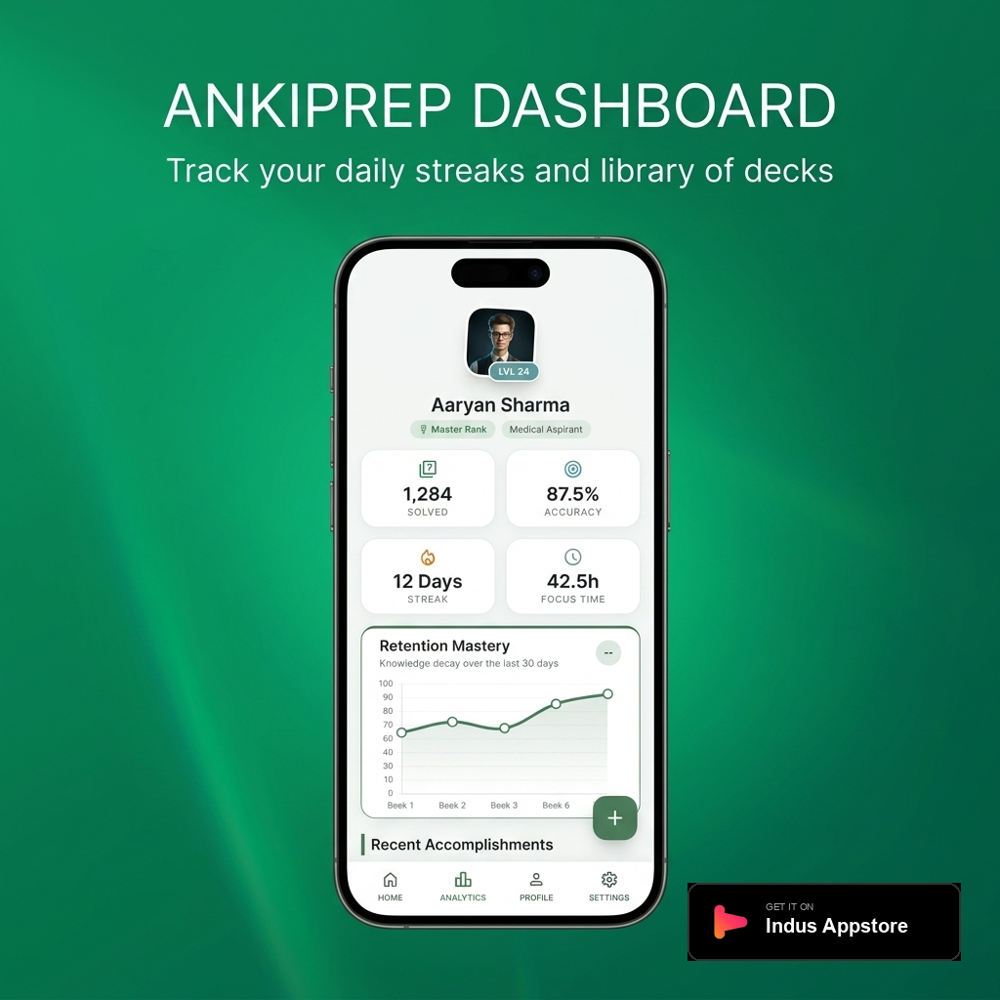

# AnkiPrep

[](https://github.com/indicreader/AnkiPrep/actions/workflows/release.yml)
[](https://github.com/indicreader/AnkiPrep/releases)
[](https://www.gnu.org/licenses/gpl-3.0)

**AnkiPrep** is an offline-first, high-performance smart flashcard and active recall learning ecosystem engineered specifically for competitive examination aspirants and serious students. Built natively using modern Android standards (**Kotlin**, **Jetpack Compose**, **Coroutines**, and **Room Database**), AnkiPrep transforms massive question banks into structured, interactive multiple-choice quizzes (MCQs), flashcards, and timed mock tests.

Whether you are preparing for UPSC, State PSCs, SSC, Banking, Railways, NEET, JEE, or University exams, AnkiPrep allows you to ingest study material from Anki packages (`.apkg`), spreadsheets (`.csv`), data dumps (`.json`), digital books (`.epub`), and past-year exam question papers (`.pdf`) directly into a clean, distraction-free study space.

<p align="center">
  
  
  
</p>

---

## 🎯 How the App Is Intended to Be Used

To achieve the highest knowledge retention and peak exam readiness, AnkiPrep is structured around an **Intended Active Recall Workflow**:

```
[Import High-Yield CSV / Material] 
               │
               ▼
   [Organize & Hierarchy Review]  ──► (Drag & Drop, Subdeck Nesting)
               │
               ▼
      [Daily Practice Mode]       ──► (Instant Feedback, Distractor Learning)
               │
               ▼
     [Spaced Revision Mode]       ──► (FSRS-Driven Algorithm, Overcoming Forgetting Curve)
               │
               ▼
     [Exam Simulation Mode]       ──► (Full Mock Exam with Negative Marking & Timers)
               │
               ▼
   [Review Mistakes & Heatmaps]   ──► (Pinpoint Weak Topics, Close Knowledge Gaps)
```

1. **Morning Ingestion & Planning:**
   - Import curated topic packages (CSV/APKG) for the subjects you plan to study.
   - Use the **Manage Decks** view to nest sub-topics under master subjects (e.g., `Polity :: Fundamental Rights`, `History :: Modern :: Freedom Struggle`).
2. **First-Pass Practice (Active Retrieval):**
   - Take newly imported decks in **Practice Mode**.
   - Answer each question actively. On submitting, review detailed explanations and instant rating tags (Again, Hard, Good, Easy).
   - Use the floating inking canvas / stylus toolbar to work out rough math, scratch notes, or jot formulas directly on the screen.
3. **Daily Revision (FSRS Algorithm):**
   - Check the **Revise** tab every morning.
   - AnkiPrep's FSRS (Free Spaced Repetition Scheduler) calculates when memory retention is about to lapse and serves cards scheduled precisely for that day.
4. **Mock Exam Simulation:**
   - Combine multiple decks and subtopics into a timed **Mock Exam**.
   - Strict exam simulation includes negative marking penalties, countdown timers, unvisited/answered question navigation drawers, and an instant post-exam performance scorecard.
5. **Mistake Review & Analytics:**
   - Tap **Review Mistakes** right after any session to isolate every question you missed.
   - Re-attempt incorrectly answered questions without resetting overall deck progress until you achieve 100% conceptual mastery.

---

## 🛒 Upcoming CSV Package Store & Marketplace

> **Note for Aspirants & Educators:**
> We are building a dedicated companion web platform where students can purchase and download topic-wise, curated CSV study packages across major competitive exam syllabi (SSC CGL/CHSL, UPSC Prelims, Banking PO/Clerk, State PSCs, Railway RRB, and General Studies).
>
> Each package will feature:
> - Verified error-free questions, options, and comprehensive bilingual explanations.
> - Hierarchical category tags mapped directly to exam syllabus topics.
> - Direct 1-tap download and instant ingestion into the AnkiPrep Android app.

---

## ⚡ Comprehensive Feature Breakdown

### 1. Offline MCQ Engine & Intelligent Distractor Generation
- **Automated Distractor Synthesis:** If a card or flashcard has only a single question and answer, AnkiPrep dynamically generates contextually and semantically similar distractor options from related cards within the same deck.
- **Support for Multi-Option Structures:** Supports multiple formats including single fact sheets, standard 4-option MCQs (`Question, Answer | Opt1 | Opt2 | Opt3`), and 5-column hierarchical sets.
- **Bilingual Question Translation:** In-line translation toggle during quizzes lets you seamlessly alternate between English and regional languages without leaving the active question view.

### 2. Multi-Format High-Performance Streaming Ingestion
- **Streaming CSV Importer:** Ingests massive CSV sets (10,000+ questions) smoothly in background worker threads without UI freezing, utilizing chunked atomic database transactions.
- **Flexible Column Mapping:** Includes an interactive column mapper that auto-detects Question, Answer, Distractor Options, Tags, and Explanations.
- **Anki `.apkg` Support:** Native parsing of SQLite Anki collections, note types, and media files.
- **Smart PDF Extraction:** Built-in PDF reader that parses past-year exam papers, questions, and option segments with on-device column boundary detection.
- **EPUB & ZIP Ingestion:** Reads digital books and chapters, segmenting chapters into individual subdecks automatically.
- **Camera / Photo Snipping OCR:** Snap a picture of a textbook or question paper with on-device ML Kit OCR to instantly crop and synthesize an MCQ card.

### 3. Deck Management, Drag-and-Drop & Ergonomic Multi-Select
- **Long-Press Multi-Select:** Clean, uncluttered deck lists with zero persistent checkboxes. Long-press any deck item to activate Selection Mode with tactile haptic feedback.
- **Batch Operations:** In Selection Mode, perform bulk actions in a single tap:
  - **Delete:** Safely remove selected decks and cards.
  - **Nest Under Master:** Group several decks into subdecks under a parent topic.
  - **Club Questions:** Merge multiple decks into a single consolidated question bank with duplicate resolution.
  - **Combined Mock / Test:** Launch an exam session combining cards from all selected decks.
- **Dedicated Drag Handle:** Reorder decks and sibling topics smoothly using dedicated drag handles without accidental touch conflicts.
- **Cyclic Hierarchy Protection:** Built-in validation prevents accidental cyclic dependencies (a parent deck cannot be dropped into its own child deck).

### 4. Spaced Repetition (FSRS & Leitner Scheduling)
- **FSRS (Free Spaced Repetition Scheduler):** State-of-the-art memory decay model predicting memory stability and retrievability.
- **5-Box Leitner System:** Visual progression of mastery across traditional interval boxes.
- **Persistent Progress Tracking:** Review states and mastery ratings remain independent from source card data. Resetting progress never alters the original cards.

### 5. In-Quiz Floating Stylus Canvas & Whiteboard Toolbar
- **Low-Latency Inking:** Floating capsule toolbar equipped with pen, pencil, and highlighter modes for quick rough work, math calculations, and mnemonics.
- **Tactile Canvas Controls:** Undo, redo, color picker, eraser, and hide/show whiteboard without losing your position in the quiz.
- **Ergonomic Floating Bounds:** Toolbar remains strictly bounded within the viewport, scrollable on smaller screens.

### 6. Full Mock Exam Engine
- **Exam Presets:** Pre-configured exam formats (SSC, Banking, UPSC) or custom scoring rules (e.g., +2.0 marks for correct answers, -0.66 for incorrect).
- **Session Timers:** Overall exam countdown timer and per-question target time alerts.
- **Question Palette Drawer:** Visual grid indicating Answered, Marked for Review, and Unvisited questions with 1-tap jump navigation.
- **Post-Exam Analytics:** Instant breakdown of accuracy, net score, negative marks, and speed per question.

### 7. Rich Analytics & Study Heatmaps
- **52-Week Activity Heatmap:** GitHub-style daily study heatmap visualizing practice, revision, and test completion consistency.
- **Streak Tracker:** Active day counters, current streaks, and longest study streaks.
- **Performance Curves:** Retention rate analysis, topic-level weakness flags, and time-distribution charts.

### 8. Customization, Themes & Direct In-App Updates
- **Theme Diversity:** Cyber-Mint Dark, Pure AMOLED Black, Warm Light, Emerald, and Ocean palettes.
- **Typography & Font Uploads:** Upload your own custom `.ttf` or `.otf` fonts for high-readability study typography.
- **Direct In-App Updates:** Check for updates and download new release APKs directly from **Settings → About Us** with automated FileProvider installation.

---

## 📥 Supported File Formats & Examples

Verified sample files can be found in the [`sample_import_files/`](sample_import_files/) folder:

### 1. Standard MCQ CSV (`sample_import_files/sample_mcq.csv`)
```csv
"Quant, Number Systems", "What is the remainder when 2^31 is divided by 5?", "3 | 1 | 2 | 4", "Cycle of powers of 2 mod 5 is 2, 4, 3, 1 (period 4). 31 mod 4 = 3, so 2^3 = 8 = 3 mod 5."
"English, Vocabulary", "Choose the closest synonym for the word: 'Ephemeral'", "Transitory | Eternal | Monotonous | Gigantic", "Ephemeral means lasting for a very short time; fleeting or transitory."
"Polity, Fundamental Rights", "Which Article guarantees the Right to Constitutional Remedies?", "Article 32 | Article 21 | Article 19 | Article 14", "Dr. B.R. Ambedkar hailed Article 32 as the heart and soul of the Indian Constitution."
```

### 2. Five-Column Hierarchical CSV (`sample_import_files/sample_5col_history.csv`)
```csv
topic, subtopic, question, answer, explaination
History, Ancient, Which river was known as Parushni in the Rigveda?, Ravi, Parushni is the Vedic name for modern river Ravi where the Battle of Ten Kings took place.
History, Ancient, Capital of the Maurya Empire under Ashoka, Pataliputra, Modern day Patna served as the seat of the Mauryan emperor.
History, Medieval, Battle of Khanwa took place in which year, 1527, Fought between the Mughal forces under Babur and the Rajput army under Rana Sanga.
```

### 3. One-Liner / Fact Sheet CSV (`sample_import_files/sample_oneliner.csv`)
```csv
question, answer, explaination
Who wrote the National Anthem of India?, Rabindranath Tagore, Jana Gana Mana was originally composed in Bengali as Bharoto Bhagyo Bidhata.
What is the SI unit of electric current?, Ampere, Named after Andre-Marie Ampere who discovered electro-magnetism.
Which layer of the atmosphere contains the ozone layer?, Stratosphere, Located roughly between 15 to 35 km altitude above Earth surface.
```

### 4. Structured Question JSON (`sample_import_files/sample_questions.json`)
```json
[
  {
    "question": "Which gas is most abundant in the Earth's atmosphere?",
    "options": ["Nitrogen", "Oxygen", "Argon", "Carbon Dioxide"],
    "answer": "Nitrogen",
    "explanation": "Nitrogen makes up roughly 78.08% of Earth's atmosphere by volume.",
    "topic": "General Science",
    "subtopic": "Atmosphere"
  }
]
```

---

## 🛠️ Tech Stack & Architecture

- **Language:** Kotlin (100% Kotlin-first implementation)
- **UI Framework:** Jetpack Compose (Material Design 3 tokens and components)
- **Local Persistence:** Room Database & SQLite with full transactional consistency
- **Asynchrony:** Kotlin Coroutines & Flow (structured concurrency)
- **Image Pipeline:** Coil Compose for embedded flashcard and option diagrams
- **ML & Parsing:** Google ML Kit Text Recognition for OCR question extraction, Jsoup for HTML sanitization
- **Algorithm:** FSRS (Free Spaced Repetition Scheduler) memory decay engine

---

## 🚀 Building & Running the Project

### Prerequisites
- **JDK 17** (Zulu or OpenJDK recommended)
- **Android SDK 34+**
- **Android Studio Ladybug** (or later)

### Build Debug Assembly
```bash
./gradlew assembleDebug
```

### Build Release APK Locally
Windows batch script for clean release builds signed with release keystore:
```bat
build-apk.bat
```
The output binary is automatically saved to the `release/` directory.

### Automated Cloud Builds via GitHub Actions
GitHub Actions workflow in [`.github/workflows/release.yml`](.github/workflows/release.yml):
1. **Pushing a Tag:** Pushing any tag starting with `v` (e.g., `git tag v5.16 && git push origin v5.16`) automatically builds a release APK and publishes a GitHub Release.
2. **Manual Trigger:** Go to **Actions → Build & Release APK → Run workflow** on GitHub to compile a release artifact anytime.

---

## 📲 Download & Installation

Pre-compiled release APKs are available under GitHub [Releases](https://github.com/indicreader/AnkiPrep/releases).

1. Download the latest **`ankiprep-*.apk`**.
2. If prompted, enable installation from unknown sources in Android device settings.
3. Open the file to install or update over your existing AnkiPrep installation.

---

## 📄 License

This project is licensed under the GNU General Public License v3.0 — see the [LICENSE](LICENSE) file for details.
